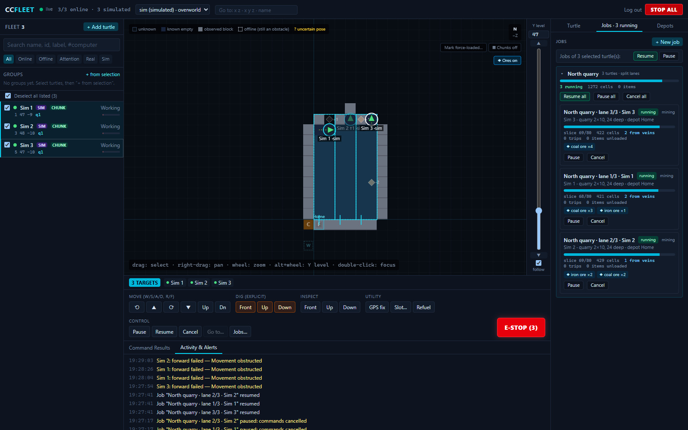
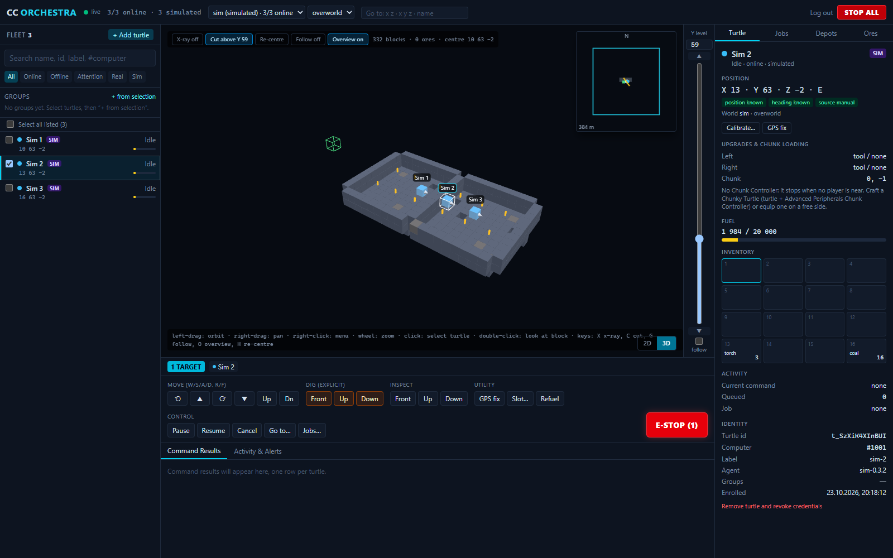
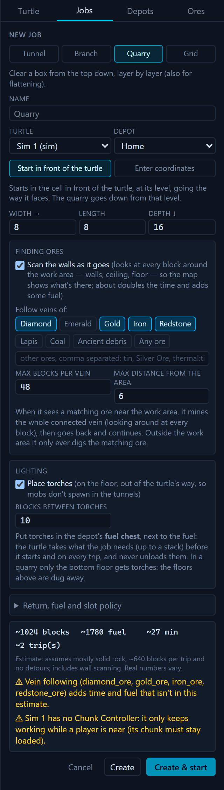
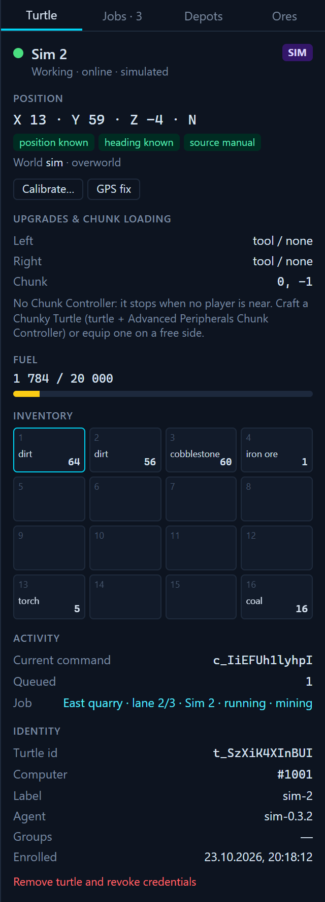
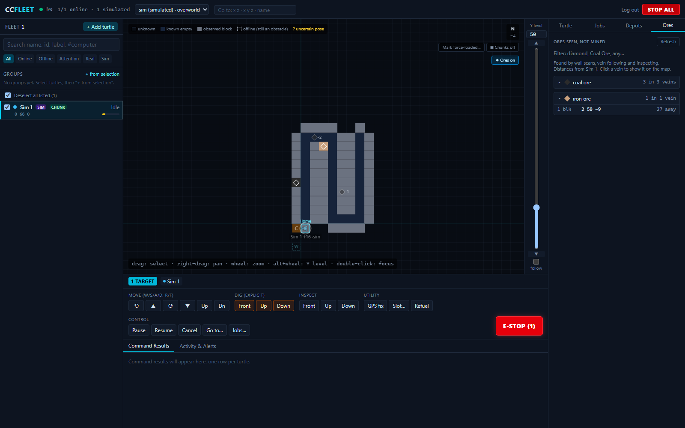
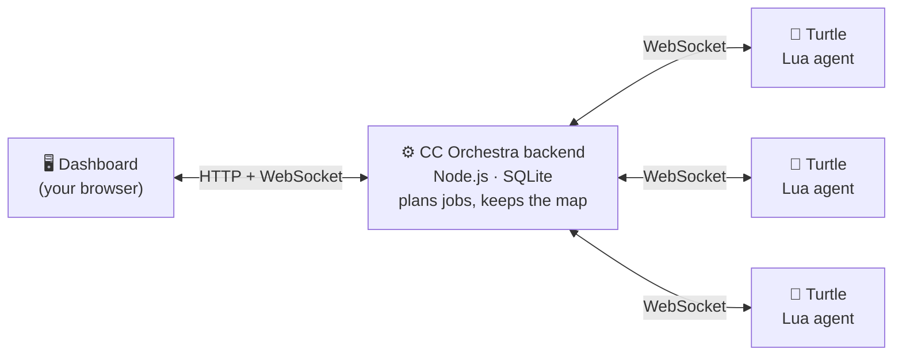

<div align="center">

# CC Orchestra

**Mission control for your [CC: Tweaked](https://tweaked.cc/) mining turtles.**

Pair your turtles once, then run them from your browser: a live map of everything they've seen, mining jobs that survive crashes and restarts, ore hunting, and a whole fleet that shares the tunnels without getting in each other's way.


[](LICENSE)



[Try it without Minecraft](#try-it-in-two-minutes-no-minecraft-needed) · [Connect real turtles](#connect-your-turtles) · [Features](#what-it-does) · [FAQ](#faq)

</div>

---

## Why CC Orchestra?

Everyone who plays with turtles knows the story: you write a mining script, send the turtle off, walk away… and come back to a turtle stuck behind gravel, out of fuel, lost after its chunk unloaded, or wandering because it forgot where home was.

CC Orchestra takes a different approach: **the brain lives on your PC, not on the turtle.** Each turtle runs a small agent that does one checked action at a time. The backend plans the work, tracks every move and keeps the map. So:

- 🔁 **Jobs survive interruptions.** Disconnects, chunk unloads, a server or backend restart: the job pauses safely and carries on from where it stopped when you press Resume.
- 🧭 **Turtles never guess where they are.** Position comes from calibration or GPS and is tracked move by move. If a move's outcome is unknown, the turtle is marked *uncertain* instead of quietly drifting off course.
- 🛡️ **It won't wreck your base.** Turtles never dig chests or other inventories, and refuse protected blocks (spawners, beds, portals, other computers…). In a job they only dig the area you gave them, plus any ore veins you asked them to follow.
- 🗺️ **You see everything.** Every block a turtle has looked at goes on a shared map, in 2D and 3D, including every ore it walked past.
- 🐢🐢🐢 **Many turtles, one plan.** Split a quarry between six turtles; they reserve cells, give way to each other in tunnels and take turns at the depot chest.

## What it does

### 🗺️ A live map, in 2D and 3D

Everything your turtles have seen, slice by slice at any Y level, with an ore overlay and a chunk overlay showing which chunks are kept loaded. Switch to **3D** to orbit around your tunnels, x-ray the stone to see the ores in the walls, cut away everything above a Y level to look into a tunnel, or have the camera follow a turtle as it works.



### ⛏️ Mining jobs that finish

**Tunnel**, **branch mine**, **grid mine** and **quarry**. Pick a turtle and a depot (a dock next to a chest, plus an optional fuel chest), then press start. When the inventory fills or fuel runs low, the turtle drives home, unloads, refuels and goes back to where it left off. Tick **Place torches** and it lights the tunnels as it goes, with torches it takes from the depot. Progress is drawn on the map as it digs. **Queue** several jobs for a turtle and it works through them one after another on its own.

<table>
<tr>
<td width="50%"></td>
<td width="50%"></td>
</tr>
<tr>
<td><sub>New job: a quarry with ore filters and torches</sub></td>
<td><sub>Turtle details: position, fuel, inventory, upgrades</sub></td>
</tr>
</table>

### 💎 Ore hunting

Have turtles **scan the walls** as they dig, or map everything within 8–16 blocks at once with an Advanced Peripherals **Geo Scanner**, and **follow ore veins** out of the tunnel and back: Diamond, Coal, "any ore", or any modded ore by id. The **Ores** tab lists every ore seen but not yet mined, grouped into veins, nearest first. Click one and the map jumps there.



### 🐢 A real fleet

- **Campaigns:** one job per turtle, or **one job shared** between them: tunnels and quarries in lanes, grid mines in bands of tunnels, and branch mines with one turtle on the corridor and the branches dealt out.
- **Traffic control:** turtles reserve the cells ahead of them, give way early when they meet head-on, and detect deadlocks.
- **Shared depot:** a queue and waiting spots, so turtles take turns at the chest.
- **Groups**, multi-select and an **emergency stop** for the whole fleet.
- **Notifications** on Discord or Slack when a job completes, needs attention or loses its turtle.

### 🎮 Hands-on control

Drive one turtle or a whole selection at once with **W/A/S/D/R/F**, and dig, inspect, refuel or pick slots from the command bar. **Right-click the map** to send a turtle to a spot, start a job right there, or pause, resume or stop a turtle. Every command shows its result for each turtle.

### 🌍 One dashboard, many worlds

Play on several servers or saves? Each gets its own **instance**, with its own turtles, map, jobs and depots. Pick it on the login screen or switch from the header at any time; turtles in every instance stay connected.

### 🧪 A simulator built in

No Minecraft open? The simulator runs turtles in a generated world over the exact same protocol, and can even run the **real Lua agent** in a CC-like host. Try everything before you set foot underground.

## How it works



The backend runs on your own PC or server; nothing goes through a cloud service. Turtles connect with CC: Tweaked's built-in WebSocket support. Every command is a single action (move, dig, inspect…): the turtle checks it, does it and reports back what it saw. It also keeps a small journal on disk, so after a crash it can tell whether its last move really happened.

## Try it in two minutes (no Minecraft needed)

You need [Node.js](https://nodejs.org/) **22.13 or newer** (24 recommended).

```bash
git clone https://github.com/v3lip/CC-Orchestra.git
cd CC-Orchestra
npm install
npm run setup        # creates .env with a random dashboard password (printed once; it's also in .env)
npm run build        # builds the dashboard
npm run start        # backend + dashboard on http://127.0.0.1:8787
```

In a second terminal, start some simulated turtles:

```bash
npm run sim -- --count 6
```

Open **http://127.0.0.1:8787**, log in with the password, select turtles and drive them with **W/S/A/D** (move and turn) and **R/F** (up and down).

**Run your first job.** The simulator world comes with a depot site: a chest west of the first turtle and a fuel chest (coal and torches) under it.

1. Select the first turtle → **Depots** → **New depot** → "Use … as the dock", facing **W**, fuel chest **below** → **Save**.
2. **Jobs** → **New job** → Tunnel, Branch mine or Quarry → "Start in front of the turtle" → **Create & start**.
3. Optional: under **Finding ores**, turn on wall scanning and vein following. (The sim world keeps its ores a few blocks below the dirt.)

<details>
<summary>More simulator options</summary>

```bash
npm run sim -- --lua --count 3 --data ./sim-data-lua   # run the real Lua agent instead of the TypeScript one
```

`--chunky` (equip a Chunk Controller), `--geo` (equip a Geo Scanner), `--count N`, `--speed 2` (faster actions), `--reset` (fresh world and turtles), `--no-calibrate` (start with an unknown position), `--no-gps`. Simulated turtles live in their own instance, `sim`, so their map never mixes with real data, and they're marked **SIM** everywhere.

</details>

## Connect your turtles

**1. Let turtles reach the backend.** CC: Tweaked blocks local network addresses by default. In your world's `computercraft-server.toml`, add one narrow allow rule for the backend's address and port, *above* the existing `$private` deny rule:

```toml
# CC Orchestra backend: only this address and port.
[[http.rules]]
    host = "127.0.0.1"
    port = 8787
    action = "allow"
```

[docs/minecraft-setup.md](docs/minecraft-setup.md) has the details: where the file is, running the backend on another machine, WebSockets.

**2. Pair a turtle.** Use a mining turtle. In the dashboard, click **Add turtle** to get a single-use pairing code, then run this on the turtle:

```
wget http://127.0.0.1:8787/turtle/install.lua install.lua
install ABCD-EFGH
```

**3. Calibrate.** Type the turtle's block coordinates (F3) and the way it faces, e.g. `120 64 -35 n`, or press Enter and calibrate from the dashboard. If you have a GPS network, **GPS fix** finds the position for you.

That's it: the turtle shows up on the map. The agent starts on boot, the turtle keeps its files when picked up (the installer labels it), and running `install` again updates it.

> **Keep the chunks loaded.** Turtles freeze when their chunk unloads. For long jobs, give the turtle an Advanced Peripherals **Chunk Controller** (a "chunky turtle"), or force-load the mining area. See [chunk loading](docs/minecraft-setup.md#4-chunk-loading--read-this).

## Compatibility

| Setup | Status |
|---|---|
| **Minecraft 1.16.5** (Forge), CC: Tweaked 1.100.2, Advanced Peripherals 0.7.7 · *FTB Ultimate Anniversary* | ✅ Tested in-game: pairing, control, every job type, multi-turtle traffic, chunky turtles, ore scanning |
| **Minecraft 1.21.1** (NeoForge), CC: Tweaked 1.120.2 · *FTB Evolution* | ✅ In use: pairing, telemetry, manual control |
| Other versions | Should work: the agent only uses long-standing CC: Tweaked APIs (HTTP WebSockets, the turtle API, JSON), and the map handles build heights from −64 to 320 |
| Backend | Windows, macOS or Linux with Node.js 22.13+, or Docker |

Advanced Peripherals is optional; it adds the Chunk Controller for chunky turtles.

## FAQ

<details>
<summary><b>The installer says the backend is blocked, or the turtle can't connect.</b></summary>

That's CC: Tweaked's HTTP rules. Add the allow rule from [Connect your turtles](#connect-your-turtles) *above* the `$private` deny rule, then restart the world. If the backend runs on another machine, use its LAN IP and set `PUBLIC_URL` in `.env` to match.
</details>

<details>
<summary><b>I updated, but a new feature doesn't work.</b></summary>

The backend only picks up new code when it restarts. After `git pull` (and `npm install` if dependencies changed), run `npm run build`, then stop the backend and run `npm start` again. The dashboard shows a **Restart the backend** banner when it's running older code. Turtles get agent updates when you run `install` on them.
</details>

<details>
<summary><b>A move fails with "Movement failed".</b></summary>

Almost always a claimed chunk: claim mods like FTB Chunks keep turtles (fake players) out. Allow fake players in your team's FTB Chunks settings, or unclaim the chunks your turtles work in. The dashboard shows this hint next to the error.
</details>

<details>
<summary><b>My turtle stops when I walk away.</b></summary>

Its chunk unloaded. Use a chunky turtle (Advanced Peripherals Chunk Controller) or force-load the mining area. A job paused this way carries on when you press Resume.
</details>

<details>
<summary><b>I play on more than one server. Will their maps mix?</b></summary>

No. Create an instance for each server or save (login screen → **＋ New instance…**) and pair that server's turtles into it. Each instance has its own map, jobs and depots.
</details>

<details>
<summary><b>Can other people reach my dashboard?</b></summary>

Not by default. The backend only listens on `127.0.0.1`, and the dashboard needs your password. Each turtle gets its own credentials when it pairs; removing a turtle in the dashboard revokes them.
</details>

## Running it for real

<details>
<summary><b>Docker</b></summary>

```bash
npm run setup        # or put ADMIN_PASSWORD=... in .env yourself
docker compose up -d --build
```

Data persists in the `fleet-data` volume. The port is bound to `127.0.0.1` only; see the comment in `docker-compose.yml` for LAN use.
</details>

<details>
<summary><b>Configuration (<code>.env</code>)</b></summary>

| Variable | Default | |
|---|---|---|
| `ADMIN_PASSWORD` | — | dashboard password (required in production) |
| `HOST` | `127.0.0.1` | bind address |
| `PORT` | `8787` | |
| `DATA_DIR` | `./data` | SQLite database location |
| `PUBLIC_URL` | `http://127.0.0.1:8787` | address turtles use; shown in pairing instructions |
| `SECURE_COOKIES` | off | set `1` behind HTTPS |
| `NOTIFY_WEBHOOK_URL` | — | a Discord or Slack webhook: a message when a job completes, needs attention, or loses its turtle |
</details>

<details>
<summary><b>Development</b></summary>

```bash
npm run dev          # backend (tsx watch) on :8787 + Vite on http://127.0.0.1:5173 (proxies /api and /ws)
npm test             # protocol unit tests + backend/simulator integration tests
npm run typecheck
```

The repository is an npm workspace: `packages/protocol` (shared message types), `apps/server` (backend), `apps/web` (React dashboard), `apps/sim` (simulator) and `turtle/` (the Lua agent and installer).
</details>

## Roadmap

1. ✅ Backend, persistence, simulator and dashboard
2. ✅ Real Lua turtles: pairing, telemetry, calibrated position, manual control
3. ✅ Reliable tunnel jobs with automatic return, unloading and resume
4. ✅ Multi-turtle scheduling, groups, depot queues and collision handling
5. ✅ Branch mine, grid mine, quarry, wall scanning, ore veins, ore search and the persistent map; sharing branch and grid mines between turtles (in the simulator so far)
6. 🟡 3D view ✅; Geo Scanner mapping ✅ in the simulator, to be confirmed in-game ([plan](docs/milestone-6.md))
7. ⬜ Minimap waypoints (JourneyMap / Xaero)

Everything marked done has been checked in-game with [the verification checklist](docs/in-game-checklist.md), except the newest work (the 3D view, the right-click menu and instances), which is tested in the simulator so far. Day-by-day notes are in [docs/progress.md](docs/progress.md).

## Documentation

- [Minecraft setup](docs/minecraft-setup.md): HTTP rules, installing the agent, fuel, chunk loading, GPS
- [In-game verification checklist](docs/in-game-checklist.md)
- [Architecture and mining strategies](docs/architecture.md)
- [Wire protocol](docs/protocol.md)
- [Progress notes](docs/progress.md)

## License

[MIT](LICENSE): free to use, modify and share, including in your own modpacks and servers. Keep the copyright notice.
